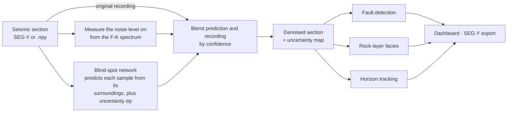

# DeepSeis

**The seismic denoiser that knows when to stop.**

DeepSeis cleans noisy seismic images without ever seeing a clean example, and keeps the
faults that ordinary filters smear away: the breaks in the rock layers where oil and gas get
trapped. It then reads the cleaned image automatically, picking faults, tracking horizons and
classifying the rock layers.

It is trained and tested on the real **F3 Netherlands** North Sea survey.

**[Live demo](https://sraha23-deepseis.static.hf.space)** ·
[Project report](DeepSeis_Project_Report.md) ·
[Data and trained models](https://huggingface.co/datasets/SRaha23/Seismic_Data)

| On 8 unseen survey lines, with known noise added | Noisy input | f-x deconvolution (industry standard) | **DeepSeis** |
|---|---|---|---|
| Signal-to-noise ratio | 6.02 dB | 10.98 dB | **13.66 dB** |
| Structural similarity (SSIM) | 0.690 | 0.848 | **0.900** |
| Fault picks that match the clean section (Dice) | 0.310 | 0.620 | **0.649** |

The rock-layer classifier scores a **0.892 mean IoU on unseen lines, across all six units**.

*Built for the MC²Plus × Oil India Ltd. × IIT Kharagpur Energy Innovation Challenge 2026,
Track 1: AI-Driven Subsurface Intelligence.*

---

## Why this matters

An exploration well is drilled on the strength of a picture. The picture comes from seismic
surveying: sound is sent into the ground, and the echoes from each rock boundary are recorded
and stacked into an image of the layers below. Oil and gas tend to collect against
**faults**, cracks where the layers have snapped and slid past each other. If the fault is not
where the image says it is, the well misses. One dry offshore well can cost more than
$100 million.

Every seismic image carries noise, and cleaning it up runs into two walls.

**Clean seismic data does not exist.** You cannot record the same shot again with the noise
switched off. The noise is part of the recording. Standard deep learning learns denoising from
matched noisy and clean pairs, so here it has to be trained on simulated data, and it then
struggles on a real survey.

**Noise and faults look alike.** On a seismic image, a fault is the place where the layers
suddenly stop being smooth. A burst of noise is too. Any filter that smooths away one smooths
away the other, so processing teams run their filters gently and live with the noise that is
left. Clean the image too hard, and you delete the reason you took it.

## How DeepSeis gets past both walls

**1. It learns from the noisy data itself.** The network predicts every sample of the image
from its surroundings only. It is built so that it physically cannot see the sample it is
predicting. Noise at one sample is independent of the noise around it, so the network cannot
learn to predict noise. The only thing it can learn to predict is the geology. No clean
example is ever needed, and the model learns each survey's own noise.

**2. It says how sure it is, and that is what protects the faults.** For every sample, the
network gives a prediction *and* an uncertainty. DeepSeis then blends that prediction with the
original recording, weighted by how much each can be trusted:

```
denoised = (prediction · σn² + recording · σp²) / (σp² + σn²)
```

Here σp is the network's uncertainty and σn is the noise level. Where the layers are smooth
and predictable, the network is confident and its prediction wins, so the noise goes. At a
fault, the surrounding data cannot predict what comes next. That is what a fault *is*. So the
network's confidence drops, and the blend falls back to the original recording. Nothing
tells the model to protect faults, and there is no setting to tune. The same formula runs at
every sample, and the arithmetic does the rest. Because the output is always a mix of a
prediction from real data and a real measurement, it cannot invent structure.

**3. It measures the noise level instead of guessing it.** How much gets removed depends on
σn, and a network left to learn σn tends to get it badly wrong. DeepSeis measures it
directly from the frequency content of the data, which alone is worth 3.1 dB. The standard
way of doing this fails silently on commercially processed seismic; DeepSeis detects that
case and switches to a method that works.

## How the system fits together



The original recording bypasses the network and goes straight to the blending step. That is
the key design choice: the network only ever proposes; the measurement always has a say.

- **The denoiser** is a 1.2-million-parameter network that trains on an ordinary laptop CPU.
  Its output scales exactly with the input amplitude, so a survey recorded at a different gain
  needs no recalibration. It cleans a whole section in a single pass.
- **Fault detection** uses a U-Net trained on synthetic sections with known faults, then
  applied to the real denoised data. This is the established FaultSeg3D workflow, run on 2D
  sections.
- **Facies classification** labels six lithostratigraphic units of the F3 block, trained on
  denoised real sections against the published interpretation.
- **Horizon tracking** follows reflectors from trace to trace and allows a jump where it
  crosses a fault, which is what geology does.

## How we know it removed noise, not geology

A denoiser is easy to make look good and hard to test honestly. Real data has real geology
but no answer key. Simulated data has an answer key but no real geology. DeepSeis gets both
at once: it adds **known noise to real F3 sections**, trains on the noisy versions only, and
scores the output against the originals. It never sees the originals while training.

- **Unseen data, properly separated.** Scores come from a test block of inlines the model
  never trained on, with a 30-line gap on each side. Neighbouring lines are 93% alike, so
  without the gap, "unseen" would mean little.
- **Opponents worth beating.** It is compared against f-x deconvolution, which is what
  processors actually run, and against smoothing along the layers, not just against blurs.
- **No flattering metric on its own.** "Signal leakage", the share of geology in what was
  thrown away, is always reported next to how much was removed, because a filter that removes
  nothing scores a perfect zero on leakage.
- **The real question, measured.** The fault detector runs on the clean, noisy and denoised
  versions of each section. How closely the picks on the denoised section match the picks on
  the clean one shows whether the interpretation survived.

## Results

Held-out test block (inlines 373–400), 8 sections. The added noise is random noise with half
the section's own standard deviation, plus steeply dipping, low-frequency events that mimic
ground roll. ± is the spread across sections.

| Method | SNR (dB) | SSIM | Signal leakage ↓ | Energy removed | Fault Dice |
|---|---|---|---|---|---|
| **DeepSeis** | **13.66 ± 0.94** | **0.900** | 0.100 | 20.9% | 0.649 |
| DeepSeis + per-section noise level | 13.79 ± 0.96 | 0.901 | 0.114 | 19.9% | 0.655 |
| DeepSeis + orthogonalization | 13.72 ± 0.94 | 0.900 | **0.059** | 20.7% | **0.661** |
| f-x deconvolution | 10.98 ± 0.75 | 0.848 | 0.370 | 13.4% | 0.620 |
| Structure-oriented smoothing | 10.45 ± 0.50 | 0.829 | 0.422 | 10.3% | 0.545 |
| 3×3 median filter | 10.39 ± 0.60 | 0.831 | 0.179 | 21.2% | 0.566 |
| Earlier masking-based denoiser (Noise2Void) | 10.32 ± 0.43 | 0.807 | 0.148 | 26.0% | 0.573 |
| Gaussian blur (σ = 1) | 10.25 ± 0.52 | 0.851 | 0.436 | 21.2% | 0.484 |
| Noisy input (removes nothing) | 6.02 ± 0.02 | 0.690 | 0.000 | 0.0% | 0.310 |

**DeepSeis beats f-x deconvolution by 2.68 dB**, and it removes more noise while discarding far
less geology: 20.9% of the input removed at a leakage of 0.100, against 13.4% at 0.370.

**The faults survive.** Picks on the noisy section match the clean-section picks at a Dice
score of 0.310. On the DeepSeis output, that more than doubles to 0.649, ahead of every
classical method. Denoising is helping the interpretation, not erasing what is being
interpreted.

**Rock layers on unseen lines.** The facies classifier is scored on inlines 101–130, which it
never trained on, behind a buffer. The mean IoU (intersection over union) is **0.892**, and
every unit clears 0.82:

| Unit | Upper North Sea | Middle North Sea | Lower North Sea | Rijnland/Chalk | Jurassic | Triassic |
|---|---|---|---|---|---|---|
| Held-out IoU | 0.979 | 0.868 | 0.962 | 0.877 | 0.826 | 0.839 |

**On the raw survey, it removes almost nothing, and that is the right answer.** The published
F3 volume is commercially processed and already quiet. Trained on it directly, DeepSeis removes
under 1% of the variance. A denoiser that made a dramatic change here would be removing geology.
This is why its capability is demonstrated with known added noise, where the result can be
checked.

**One feature was tested and found unnecessary.** An extra training penalty for blurring
faults was built and carefully tested. A matched experiment found no measurable benefit
(13.82 dB without it, 13.66 dB with it, well inside the ±0.97 dB spread), because the blending
step already keeps the recording wherever the network cannot predict it. The penalty is now
off by default. The published checkpoints were trained with it on, which makes no
measurable difference.

The full method, every metric, the ablation and the frequency analysis are in the
[project report](DeepSeis_Project_Report.md).

## Try it

**[Live demo](https://sraha23-deepseis.static.hf.space)**: the controlled test on every
held-out line, with a before/after slider, fault picks on clean, noisy and denoised sections,
facies on unseen lines, and the full benchmark. It opens instantly; nothing is computed while
you watch.

**The full interactive dashboard** runs locally in a few minutes:

```bash
pip install -r requirements.txt     # Python 3.11; CPU-only PyTorch, no GPU needed
streamlit run app/dashboard.py      # opens http://localhost:8501
```

The trained models ship with the repository. The F3 survey (about 360 MB) downloads
automatically from Hugging Face on first launch.

| Tab | What it shows |
|---|---|
| Denoise | Raw input, denoised section and the difference, plus the per-sample uncertainty map. Below that, a controlled experiment with live noise sliders, and the benchmark table loaded from the results file. |
| Fault segmentation | Fault probability overlaid on the noisy and denoised sections |
| 3D view | The survey as a block, with denoised inline and crossline faces and a chair cut |
| F3 Survey explorer | Scrub through all 401 inlines of the real survey |
| Facies | Held-out scores per unit, the predicted map against the published interpretation, and where they disagree |
| Export | Download a denoised section as SEG-Y or NumPy |
| Diagnostics | F-K spectra before and after, energy kept per frequency band, and the signal-leakage map |

Once the data is on disk, DeepSeis runs entirely offline. No cloud service sees the data, which
matters because seismic data is among the most confidential assets an operator owns.

## Reproduce the results

<details>
<summary>From raw data to every number above</summary>

```bash
pip install -r requirements.txt

# Download the F3 Netherlands volume and facies labels (~1 GB, from Zenodo)
python data/download_f3.py

# Denoiser, validation mode: known noise is added to real sections, the model trains on the
# noisy versions only, and it is scored against the originals
python -m deepseis.denoise --config configs/denoise.yaml

# Denoiser, field mode: trained on the raw survey; this is the model the dashboard serves
python -m deepseis.denoise --config configs/denoise.yaml --field --run-dir runs/denoise_field

# Interpretation heads (faults, facies), trained on the denoised survey
python -m deepseis.train --config configs/default.yaml --blindspot runs/denoise_field/blindspot.pt

# Benchmark against every baseline, the earlier model, and the structure-term ablation
python -m deepseis.train --config configs/default.yaml --train-legacy-denoiser
python -m deepseis.denoise --config configs/denoise.yaml --no-structure --run-dir runs/denoise_nostruct
python -m deepseis.evaluate --checkpoint runs/denoise/blindspot.pt --split test \
       --legacy runs/default/denoiser.pt --compare no_structure=runs/denoise_nostruct/blindspot.pt

# Test suite: 179 tests that check properties, not just that the code runs
pytest tests/
```

`docker build -t deepseis . && docker run -p 8501:8501 deepseis` does the same in a
container: it downloads the data, retrains the interpretation models on the shipped denoiser,
and opens the dashboard.

</details>

## Limitations and next steps

- **Line by line, not full 3D.** Sections are denoised one at a time. Running on whole
  volumes is an engineering step that needs a GPU, not new research.
- **One survey so far.** F3 is well-processed North Sea data. Older surveys from Indian basins
  such as Cambay, Krishna-Godavari and Assam are noisier. Because the model learns each
  survey's own noise, that is where it should help most, but it has not yet been tested there.
- **No real fault labels.** F3 has no interpreted fault set, so fault preservation is measured
  against picks on the clean section rather than against an interpreter's faults.
- **Coherent noise.** The controlled test includes ground-roll-like events. Field-grade
  coherent noise (strong ground roll, multiples) has not been tested.

Next come full 3D volumes, one archived survey processed inside an operator's own network,
scoring against interpreted faults, and a hardened SEG-Y round trip so DeepSeis sits in a
production processing chain as one more step.

## Repository layout

```
app/dashboard.py              Streamlit dashboard (7 tabs)
deepseis/
  models/                     blind-spot denoiser, fault and facies networks
  losses/                     likelihood objective, structure-preservation terms
  noise_estimate.py           measures the noise level from the F-K spectrum
  denoise.py                  trains and serves the denoiser
  evaluate.py                 held-out benchmark against every baseline
  baselines.py                f-x deconvolution, structure-oriented smoothing, blurs
  interpretation/             horizon tracking
  io/                         F3 and SEG-Y loading, splits, noise injection
configs/                      denoiser and interpretation settings
runs/                         trained checkpoints and evaluation reports
tests/                        property tests (179)
DeepSeis_Project_Report.md    method, evaluation protocol and full results
```

## Data and references

**Data.** F3 Netherlands block, a public 3D marine survey from the Dutch North Sea, courtesy
of dGB Earth Sciences. This project uses the 401 × 701 × 255 training volume and the six-unit
facies interpretation of Alaudah et al. (2019),
[Zenodo 3755060](https://zenodo.org/record/3755060).

**Key references.** Laine et al. 2019 (blind-spot networks and the Bayesian combination step) ·
Krull et al. 2019 (Noise2Void) · Batson & Royer 2019 (Noise2Self) · Mohan et al. 2020
(bias-free denoising networks) · Canales 1984 (f-x deconvolution) · Chen & Fomel 2015 (local
signal-and-noise orthogonalization) · Wu et al. 2019 (FaultSeg3D) · Alaudah et al. 2019
(F3 facies benchmark). The full bibliography is in the
[project report](DeepSeis_Project_Report.md#references).

**Author.** Soubhagya Raha, IIT Kanpur.
